# Sevak: UML Diagrams

**For discussion** · **Updated:** 2026-10-31 · Based on [`REQUIREMENTS.md`](REQUIREMENTS.md) and the
prototype in [`app/`](../app/)

These diagrams are a starting point for discussion, not a final design. Each one says whether it
shows **what the prototype does today** or **the proposed back end** from
[`ARCHITECTURE.md`](ARCHITECTURE.md). IDs such as SGN-5 refer to the requirements.

GitHub draws these diagrams automatically. To edit one, change its text and the picture updates.

1. [Who uses Sevak and what they do](#1-who-uses-sevak-and-what-they-do) (use cases)
2. [Data model](#2-data-model) (class diagram)
3. [Life of an event](#3-life-of-an-event) (state diagram)
4. [Life of a sign-up](#4-life-of-a-sign-up) (state diagram)
   - [Verifying an organization](#4a-verifying-an-organization) (state diagram)
5. [A volunteer signs up](#5-a-volunteer-signs-up) (sequence diagram)
6. [Signing in by email](#6-signing-in-by-email) (sequence diagram)
7. [Joining an organization's team](#7-joining-an-organizations-team) (activity diagram)
   - [Joining as a volunteer](#7a-joining-as-a-volunteer) (activity diagram)
8. [How the system fits together](#8-how-the-system-fits-together) (component and deployment diagram)

---

## 1. Who uses Sevak and what they do

*Today and planned.* Actors on the left and right; the things they do in the middle. A person can be
a volunteer and a host team member at the same time (VOL-13). Items marked *(planned)* aren't in the
prototype yet.

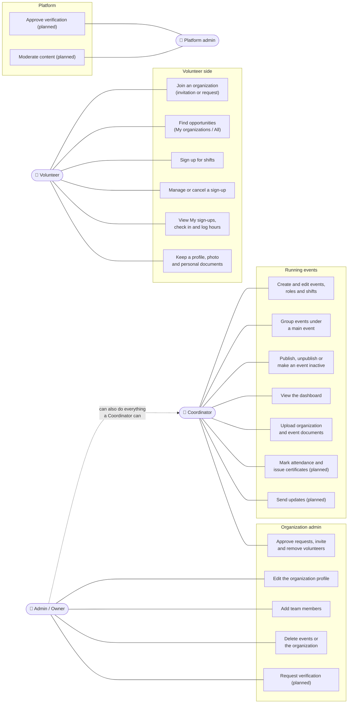

An Admin can do everything a Coordinator can, plus the *Organization admin* items (ORG-5, ORG-13,
EVT-19).

**To discuss:** should Coordinators be able to add team members, or only Admins (today: only
Admins)?

---

## 2. Data model

*Proposed back end.* The entities from §8 of the requirements, plus what the prototype has added
since: documents (ORG-12, EVT-18, VOL-14), the profile's photo and *Get to know me* fields (VOL-15,
VOL-16), services, and inactive events (EVT-19). Only the main fields are shown.

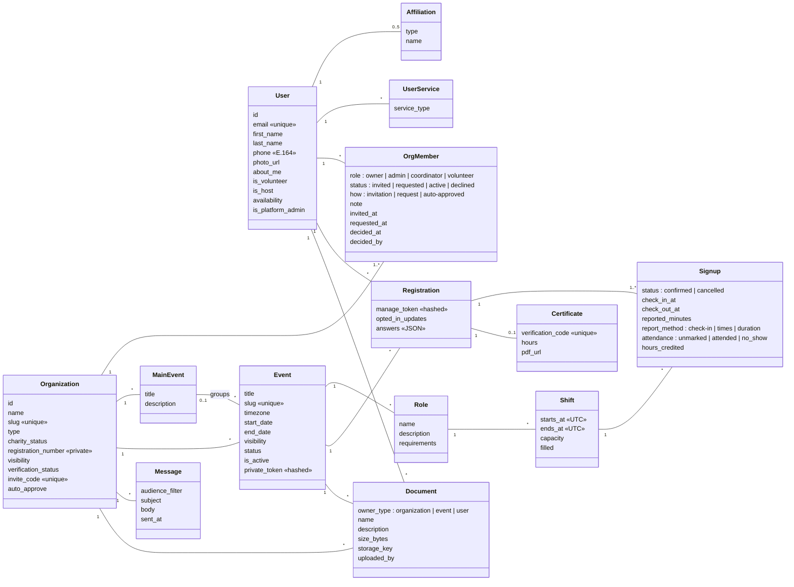

Not shown: VerificationRequest, Invite and MessageDelivery. This is the shape of the data, not a
choice of database.

**To discuss:**
- `Document` points at its owner with `owner_type` + `owner_id`. The alternative is three link
  tables, which lets the database enforce the link but adds tables.
- Should a guest volunteer (no account) still get a `User` row, keyed by email? The proposal says
  yes: it keeps *My sign-ups* simple when they sign in later.

---

## 3. Life of an event

*Today (prototype) and planned.* An event's **status** (EVT-4, EVT-15) and its **inactive** flag
(EVT-19) are separate: making an event inactive hides it without losing its status, and
**Reactivate** puts it back exactly as it was. That's why there are two inactive boxes. Any team
member can make an event inactive; only Admins can delete one, from any state.

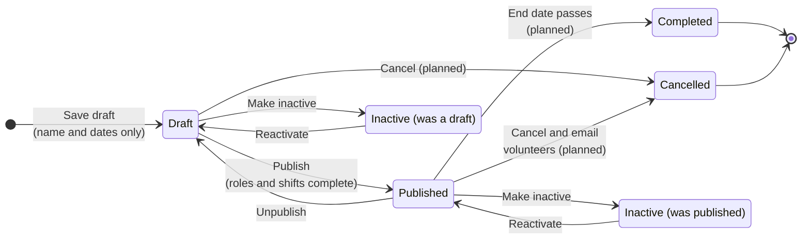

| State | Volunteers can find it | Volunteers can sign up | On the dashboard |
|---|---|---|---|
| Draft | No (host preview only) | No | Yes, if the filter includes drafts |
| Published | Yes, if public and the organization is verified | Yes | Yes |
| Inactive | No (its link says it's no longer available) | No | No |
| Completed / Cancelled | No | No | No (past or cancelled) |

**To discuss:** can a published event with sign-ups be deleted, or only made inactive or cancelled?

---

## 4. Life of a sign-up

*Proposed back end.* One `Signup` is one volunteer on one shift. On the day the volunteer can
check in and out, or log their hours afterwards (ATT-12); those are *reported* hours. Attendance
and the hours *credited* are then confirmed by the host, after the shift (ATT-2, ATT-3, ATT-5).

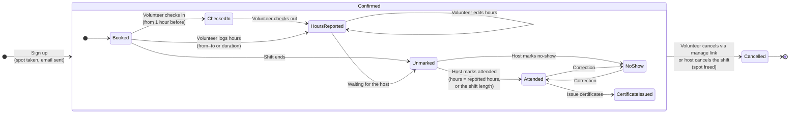

---

## 4a. Verifying an organization

*Today (prototype) and planned.* An Admin asks; Sevak's staff decide (ORG-3, ADM-1). In the
prototype the review queue is `app/review.html` and emails go to the outbox.

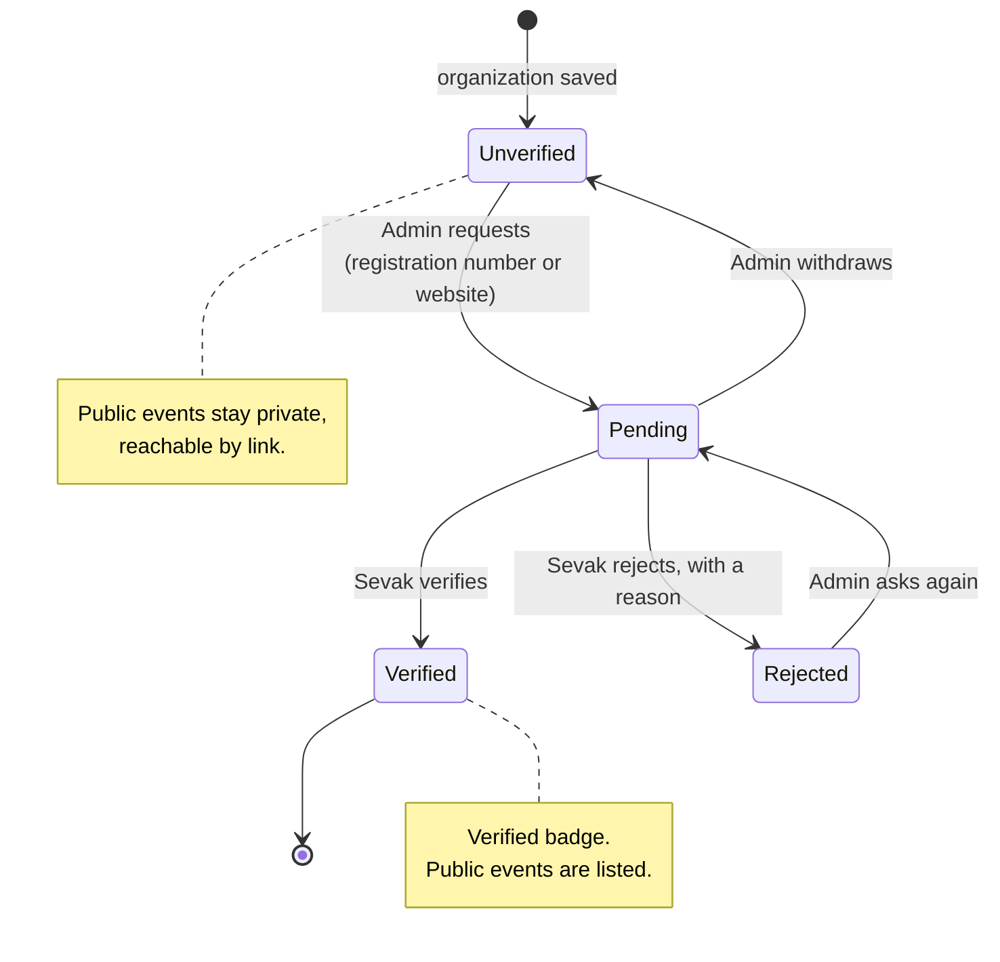

---

## 5. A volunteer signs up

*Proposed back end.* The most important flow (SGN-2, SGN-5, SGN-6, COM-1). Everything inside the
transaction happens together or not at all, so a shift can never be overbooked and an email is
never sent for a sign-up that failed.

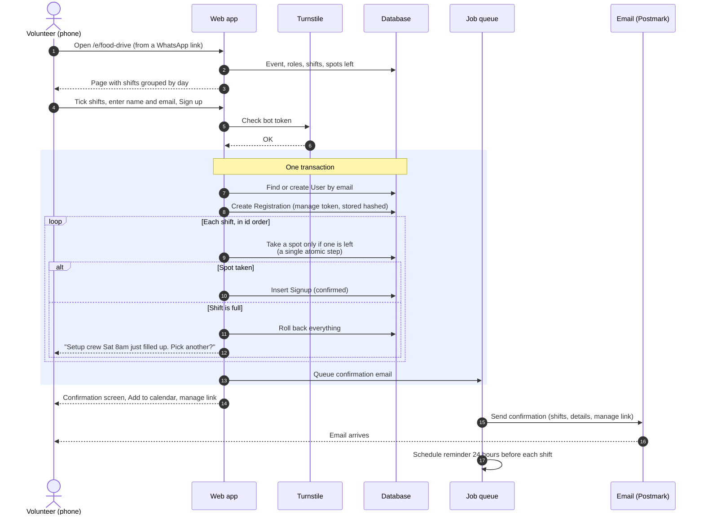

---

## 6. Signing in by email

*Proposed back end.* Passwordless sign-in (VOL-1, NFR-4). The email has both a **link** and a
**6-digit code**: on iPhone, an app added to the home screen doesn't share sign-in with Safari, so
the code lets people finish signing in inside the installed app.

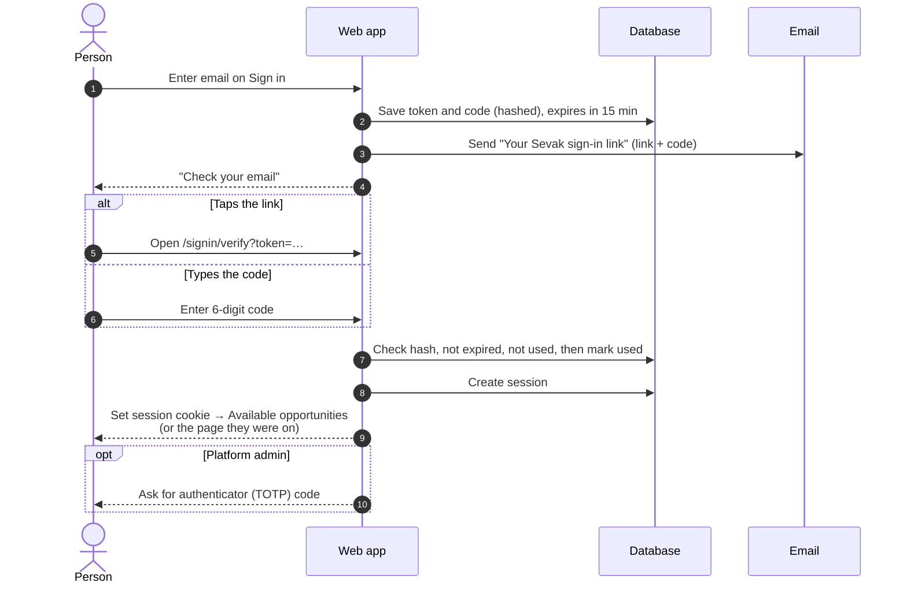

---

## 7. Joining an organization's team

*Today (prototype) and planned.* The two ways onto a team (ORG-13). In the prototype, being added
shows a one-time notice; in the live app it sends an invitation to accept.

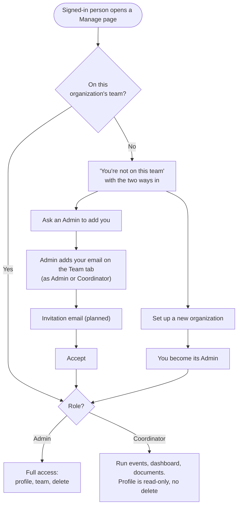

---

## 7a. Joining as a volunteer

*Today (prototype) and planned.* A volunteer can sign up for an organization's shifts only once
they're one of its volunteers: by invitation, or by asking to join and being approved (MEM-1 to
MEM-8). In the prototype, emails go to the outbox page instead of being sent.

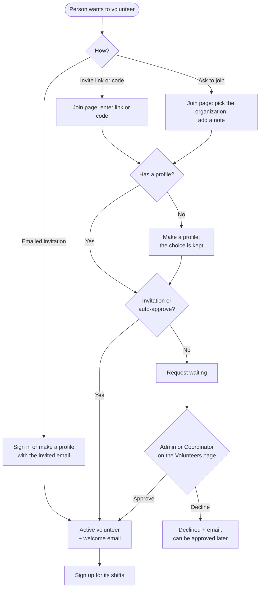

---

## 8. How the system fits together

*Today vs proposed.* Today everything runs in the browser. The proposal (from `ARCHITECTURE.md`,
updated for the cheaper single-service setup on Railway that we discussed) adds one app server and
one database.

**Today: static prototype**

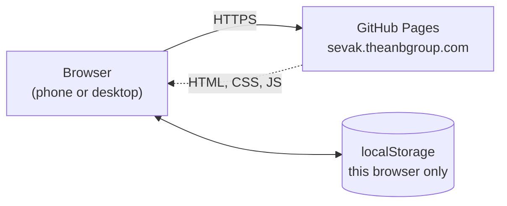

**Proposed: pilot back end**

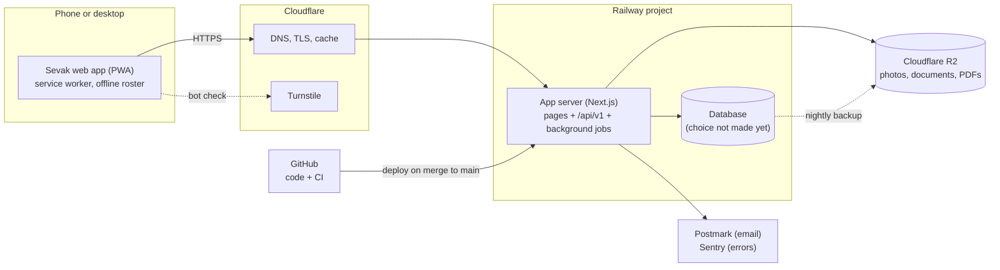

**To discuss:** the stack, the database and the host (Railway) aren't confirmed yet.
`ARCHITECTURE.md` still describes Render with a separate worker, and gets updated once this is
agreed.
